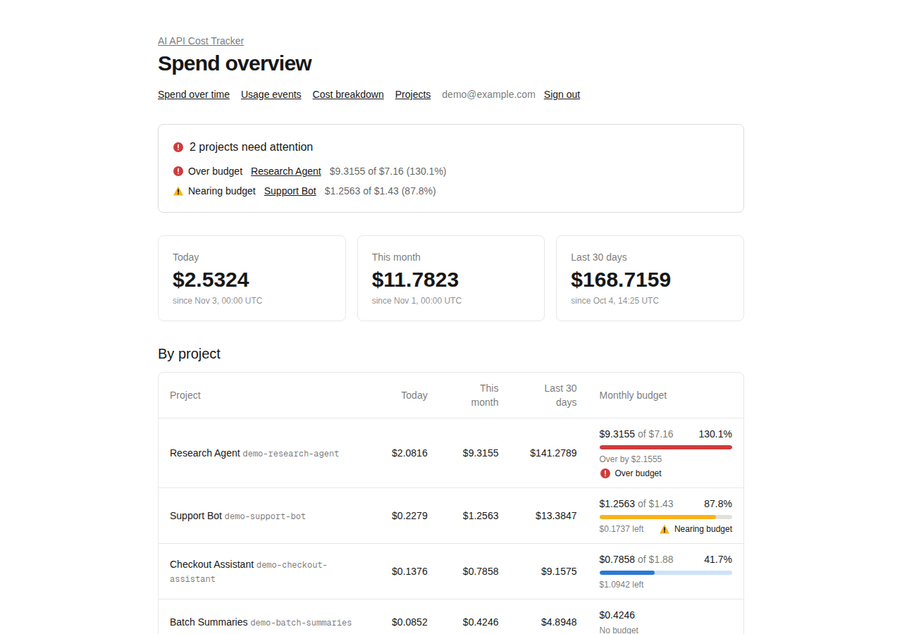
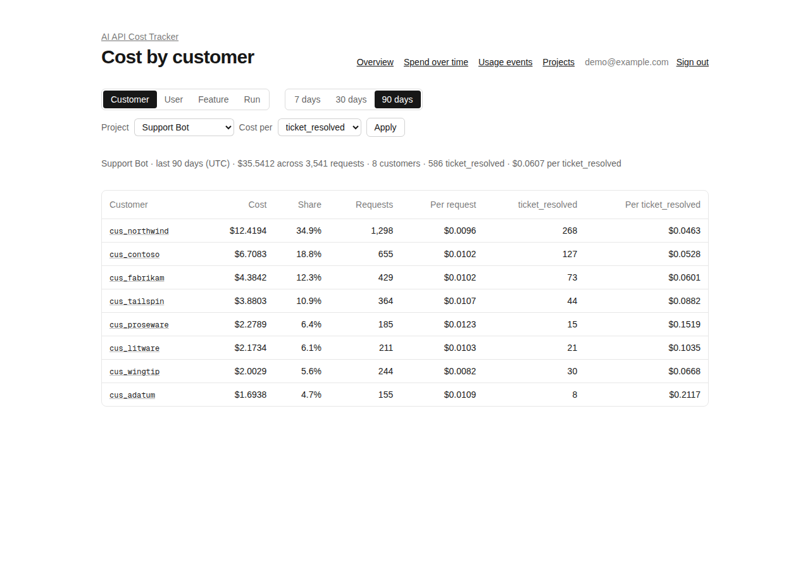
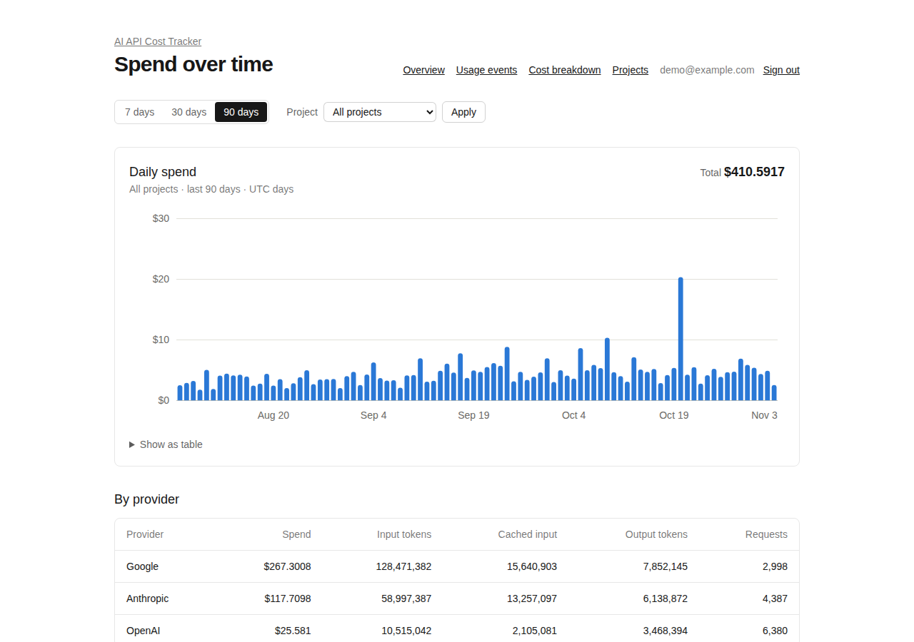
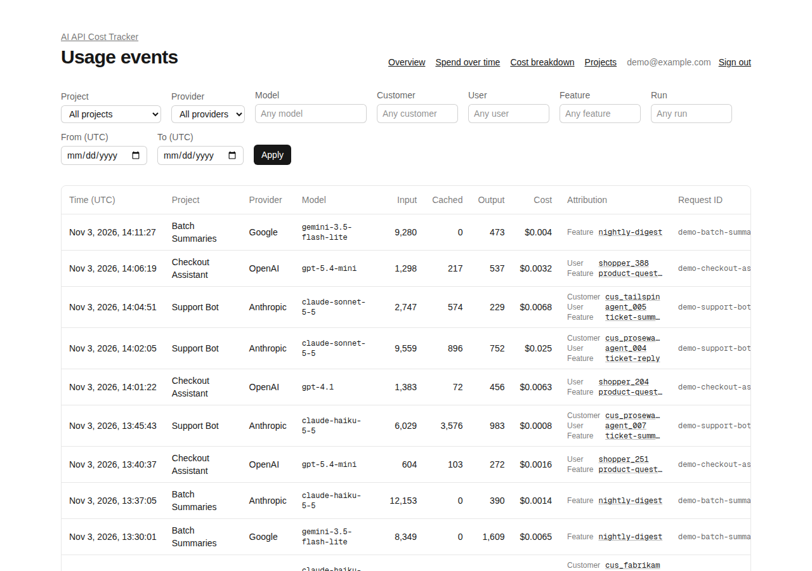

# AI API Cost Tracker

A lightweight, self-hosted ledger of what your AI API calls cost. Your app sends the token counts from each request; the tracker prices them exactly against dated, tier-aware model prices and shows spend by project, provider and model, with monthly budgets and alerts. **Prompts and responses are never sent or stored**, only token counts.

It complements LLM gateways (which route requests and cap spend) and tracing tools (which follow a request through an agent) rather than replacing them: it's the system of record for cost. Cost per customer, feature and agent run is next on the [roadmap](docs/ROADMAP.md#milestone-7-cost-by-customer-feature-and-agent-run).

<picture>
  <source media="(prefers-color-scheme: dark)" srcset="docs/screenshots/overview-dark.png">
  
</picture>

<picture>
  <source media="(prefers-color-scheme: dark)" srcset="docs/screenshots/breakdown-dark.png">
  
</picture>

| Spend over time                                                                                                                                                                                                                        | Usage events                                                                                                                                                                                                                                    |
| -------------------------------------------------------------------------------------------------------------------------------------------------------------------------------------------------------------------------------------- | ----------------------------------------------------------------------------------------------------------------------------------------------------------------------------------------------------------------------------------------------- |
| <picture><source media="(prefers-color-scheme: dark)" srcset="docs/screenshots/spend-dark.png"></picture> | <picture><source media="(prefers-color-scheme: dark)" srcset="docs/screenshots/usage-dark.png"></picture> |

<sub>Demo data from `npm run db:demo`, captured by CI on 3 November 2026, and shown in your GitHub theme. The breakdown shows cost per resolved ticket for the Support Bot, the project that resolves tickets. The demo sets budgets from the current month's spend, so they're small this early in a month.</sub>

> **Status:** Milestones 0–5 are complete: exact, tier-aware pricing, authenticated ingestion, the dashboard, budgets with alerts, Docker deployment, demo data, rate limiting and the public release. Milestone 6 added the TypeScript and Python clients, OpenTelemetry intake and bill reconciliation (Gemini billing aside). Milestone 7 added cost by customer, feature, agent run, tag and outcome, CSV and FOCUS exports and a reporting API. Milestone 8, guardrails, is under way: budget notifications and a budget check before spending are done; see [docs/ROADMAP.md](docs/ROADMAP.md).

## Features

- **Exact costs.** Input, cached input, cache writes and output are priced separately, including prompt-length tiers such as Claude Haiku 5.5 above 100,000 tokens. Money is stored as exact decimals, never floating point.
- **Dated prices.** A price change never rewrites history. Seed prices for Anthropic, OpenAI and Google models record their official source and the date they were checked.
- **One small API.** `POST /api/usage` with a per-project API key, or the [TypeScript](clients/typescript/README.md) and [Python](clients/python/README.md) clients, which read usage from OpenAI, Anthropic and Gemini responses, or [OpenTelemetry traces](docs/OPENTELEMETRY.md) with GenAI token attributes. Retries with the same `requestId` are safe.
- **Dashboard.** Spend today, this month and over 30 days; a daily chart over 7, 30 or 90 days with spend by provider and model; a filterable history of every request; light and dark mode.
- **Budgets.** A monthly budget per project, with alerts at 80% and 100%, also sent to a webhook or Slack, and an optional per-run budget. Apps can ask before spending whether a run or the month has room left.
- **Secure by default.** API keys and sessions are stored only as hashes, passwords with scrypt, and sign-in and API keys are rate limited.
- **Self-hosted.** Docker Compose or Vercel with hosted Postgres, under the MIT license.

## Quick start with Docker

About five minutes with Docker installed:

```bash
git clone https://github.com/Dominic6018/ai-api-cost-tracker.git
cd ai-api-cost-tracker
docker compose up -d --build                          # Postgres, migrations and the app

docker compose run --rm migrate npm run db:seed       # model prices and a sample project
docker compose run --rm migrate npm run db:demo       # optional: four demo projects, 90 days of usage

# Create your account; the password is read from standard input (12+ characters)
echo 'choose a long password' | docker compose run --rm -T migrate npm run --silent user -- create --email you@example.com
```

Open http://localhost:3000 and sign in. To record real usage, create an API key ([Recording usage](#recording-usage)); remove the demo with `docker compose run --rm migrate npm run db:demo -- --remove`. For HTTPS, secrets and backups in production, see **[docs/DEPLOYMENT.md](docs/DEPLOYMENT.md)**.

## Limitations

What it doesn't do yet, and where that's planned:

- **Usage is reported by your code**, through the API or the [TypeScript](clients/typescript/README.md) and [Python](clients/python/README.md) clients, or OpenTelemetry traces. Importing usage from provider billing APIs is next ([Milestone 6](docs/ROADMAP.md#milestone-6-automatic-usage-capture)).
- **Cost is broken down by project, provider and model.** Per customer, feature and run comes in Milestone 7; `metadata` is stored but not yet filterable.
- **Budget alerts appear on the dashboard only**, with no email, Slack or webhook notifications (Milestone 8).
- **Prices are token prices, managed as seed data**, with no admin screen (Milestone 9). Batch and priority tiers, non-token charges (search, images, audio) and longer-lived cache writes aren't priced, and OpenAI's long-context tiers aren't seeded.
- **One team per install.** Every account sees and manages every project, there are no roles (Milestone 10), and accounts are created and reset from the command line.
- **Days are UTC days** for "today", "this month" and the charts.

## Tech stack

| Layer      | Choice                                        |
| ---------- | --------------------------------------------- |
| Framework  | Next.js 16 (App Router), React 19             |
| Language   | TypeScript (strict)                           |
| Styling    | Tailwind CSS v4                               |
| Database   | PostgreSQL 17                                 |
| ORM        | Drizzle ORM + drizzle-kit migrations          |
| Validation | Zod                                           |
| Testing    | Vitest                                        |
| CI         | GitHub Actions (lint, typecheck, test, build) |

## Getting started

### Prerequisites

- Node.js 20.9+ (24 recommended)
- PostgreSQL 17, either via Docker (`docker compose`) or a local install

### Setup

```bash
npm install

# Environment: Next.js reads .env.local, drizzle-kit reads .env
cp .env.example .env.local
cp .env.example .env

# Start the development database (or point DATABASE_URL at your own Postgres)
docker compose up -d db

# Create the schema, then add a sample project and model prices
npm run db:migrate
npm run db:seed

npm run dev
```

Open http://localhost:3000.

To run the whole stack in Docker instead, see the [quick start](#quick-start-with-docker). For production, including HTTPS, secrets, managed hosting (Vercel and hosted Postgres) and creating the first account, see **[docs/DEPLOYMENT.md](docs/DEPLOYMENT.md)**.

## Scripts

| Script                     | Purpose                                                               |
| -------------------------- | --------------------------------------------------------------------- |
| `npm run dev`              | Start the dev server                                                  |
| `npm run build`            | Production build                                                      |
| `npm run lint`             | ESLint                                                                |
| `npm run typecheck`        | TypeScript type check                                                 |
| `npm test`                 | Run unit tests once                                                   |
| `npm run test:integration` | Run database integration tests (needs a migrated `DATABASE_URL`)      |
| `npm run format:check`     | Prettier check (`npm run format` to fix)                              |
| `npm run db:generate`      | Generate a migration from `src/db/schema.ts`                          |
| `npm run db:migrate`       | Apply pending migrations                                              |
| `npm run db:seed`          | Add sample data and model prices (safe to re-run; not for production) |
| `npm run db:demo`          | Load demo projects and 90 days of usage (`-- --remove` deletes them)  |
| `npm run api-key`          | Create or revoke ingestion API keys (see Recording usage)             |
| `npm run user`             | Create, list and reset dashboard accounts (see Dashboard)             |
| `npm run reconcile`        | Compare recorded costs with Anthropic's or OpenAI's bill (see below)  |
| `npm run budget-alerts`    | Send budget notifications to a webhook or Slack (see below)           |
| `npm run db:studio`        | Open Drizzle Studio                                                   |

## Project structure

```
src/
  app/            Next.js App Router pages and layouts
    api/usage/    POST /api/usage route and its request handler
    api/budget/check/  POST /api/budget/check: allow or deny before spending
    login/        Sign-in page and sign-in/sign-out actions
    overview/     Spend totals for today, this month and the last 30 days
    spend/        Daily spend chart and provider/model breakdown
    usage/        Usage events table with filters and pagination
    projects/     Projects list, create and edit pages (server actions)
  db/
    schema.ts     Drizzle schema (projects, model_pricing, usage_events)
    index.ts      Server-only database client
    pricing.ts    Look up the price in effect for a model at a time
    usage.ts      Price and store a usage event
    api-keys.ts   Create, authenticate and revoke API keys
    projects.ts   List, get, create and update projects
    spend.ts      Spend totals per window, per project and overall
    spend-series.ts  Daily spend and provider/model breakdown queries
    usage-events.ts  Keyset-paginated usage event listing
    auth.ts       Users, password checks and sessions
    accounts.ts   Password reset, session revocation and account list
    budget-notifications.ts  Sends each budget notification once, retrying failures
    budget-check.ts  Caps and spend for the budget check, in one query
    scripts/      `npm run api-key`, `user`, `db:demo`, `reconcile` and `budget-alerts` commands
    seed/         Sample project and dated model prices (`npm run db:seed`)
    demo/         Deterministic demo data generator and loader (`npm run db:demo`)
  lib/
    cost.ts       Token cost calculation and USD formatting
    env.ts        Environment variable validation
    pricing.ts    Effective-price selection and numeric parsing
    usage.ts      Usage payload validation
    api-keys.ts   Key generation, hashing and Bearer parsing
    auth.ts       Current user and requireUser() for pages and actions
    login.ts      Sign-in form validation
    passwords.ts  scrypt password hashing
    rate-limit.ts Rate limit rules, hashed keys and client IP
    sessions.ts   Session tokens and safe post-login redirects
    spend.ts      UTC spend window boundaries
    spend-series.ts  Chart ranges, day filling and axis ticks
    budget.ts     Exact budget use, alert thresholds and statuses
    budget-notifications.ts  Alert planning, webhook and Slack payloads, signing
    budget-check.ts  Budget check payloads and the exact allow/deny rule
    usage-filters.ts Usage filter parsing, date bounds and cursors
    projects.ts   Project form validation
drizzle/          Generated SQL migrations
Dockerfile        Multi-stage image: tools (migrations, CLI) and a non-root standalone runtime
docs/DEPLOYMENT.md  Deployment guide
docs/OPENTELEMETRY.md  OpenTelemetry intake and Collector setup
scripts/          End-to-end smoke tests and screenshots run in CI
clients/typescript/  Dependency-free client that reports usage from provider responses
clients/python/      The same for Python, standard library only
docs/ROADMAP.md   Development roadmap
```

## Data model

- **projects**: a grouping of usage (app, team, or environment) with an optional monthly budget and an optional run budget (the most any one `run_id` may spend in total).
- **model_pricing**: USD-per-million-token prices per provider/model, versioned by `effective_from`/`effective_to` so historical costs stay accurate when prices change. Optional columns hold a cache-write rate, and a **prompt-length tier**: a token threshold plus a second set of rates. A request with more input tokens than the threshold (counting cached and cache-write tokens) pays the long rates for every token, including output. A database check makes sure a threshold always comes with long input and output rates.
- **usage_events**: individual requests with token counts (including cached and cache-write input tokens), computed `cost_usd`, and an optional provider `request_id` for de-duplication.
- **rate_limits**: fixed-window attempt counters for sign-in and API keys. Keys are SHA-256 hashes, so attempted emails and client IPs aren't stored. Ended windows are deleted as new attempts arrive.
- **budget_notifications**: budget notifications sent, unique per project, month, threshold and destination, with the spend and budget the message reported.

Monetary values use Postgres `numeric` rather than floating-point columns.

### Seed prices

`npm run db:seed` loads prices from [src/db/seed/data.ts](src/db/seed/data.ts). Each entry records its official source URL and the date it was checked. Prices apply from the date they were checked, so earlier usage has no price. Claude Haiku 5.5 (over 100,000 tokens) and Gemini 2.5 Pro (over 200K) are seeded with their long-prompt tiers, and Claude models with their 5-minute cache-write rates. OpenAI's tiered flagships aren't seeded, because their long-context rates couldn't be verified from the pricing page's source. Longer-lived cache writes (Anthropic 1-hour, OpenAI 12-hour) cost more than the rate stored, so they're under-priced. Re-running the seed never overwrites existing rows, so a database seeded before cache-write rates were added keeps its old rows; reset it, or add a new row with a later `effectiveFrom`, to pick them up.

## Demo data

```bash
npm run db:seed    # prices first
npm run db:demo    # demo projects and 90 days of synthetic usage
```

Loads four projects with about 14,000 usage events across the seeded Anthropic, OpenAI and Google models. The data includes cache reads and writes, long prompts that hit pricing tiers, weekday patterns, growth, and a runaway-agent spike. Each project tells one story: **Support Bot** is nearing its budget, **Research Agent** is over it, **Checkout Assistant** is comfortably within it, and **Batch Summaries** has no budget.

The usage is attributed too, so the [cost breakdown](#dashboard) has something to show:

- **Support Bot** serves eight customer accounts, a few of them large, through twelve support agents, split between ticket replies and summaries.
- **Research Agent** works in agent runs of 4–12 requests, each for one customer. Its spike is a single runaway run, the most expensive of all.
- **Checkout Assistant** serves shoppers, so it has users but no customer accounts.
- **Batch Summaries** sets only a feature, so its customer, user and run are **Not set**.

The Support Bot also records a `ticket_resolved` outcome per customer, one per three ticket replies, so the breakdown can show [cost per resolved ticket](#recording-outcomes).

- **Deterministic:** the same `--seed` (default 2026) on the same day gives the same data. Attribution uses its own random stream, so adding it changed no token count, cost or timestamp. Budgets are set from this month's spend, so the four budget states hold on any day.
- **Priced at today's seed prices** using the app's real cost code, since history before the prices' check date has no stored price.
- **Safe to re-run:** it replaces earlier demo data in one transaction. Demo projects have slugs starting with `demo-`, and only those are touched. `npm run db:demo -- --remove` deletes them and their usage.
- **Refuses to run when `NODE_ENV=production`** unless you pass `--allow-production` (see [Deployment](docs/DEPLOYMENT.md) for a public demo).

## Dashboard

The dashboard requires signing in. Create an account from the command line. The password is read from standard input, so it doesn't end up in your shell history, and it must be at least 12 characters:

```bash
npm run user -- create --email you@example.com < password.txt
```

Then sign in at `/login`. Signed-out visitors to dashboard pages are sent there and returned afterwards.

Accounts are managed from the same command:

```bash
npm run user -- list                                        # emails and active session counts
npm run user -- reset-password --email you@example.com < password.txt
npm run user -- revoke-sessions --email you@example.com     # sign out everywhere
```

`reset-password` follows the same password rules, signs the user out everywhere, and lifts any sign-in lockout on that email. `revoke-sessions` keeps the password; use it when a device is lost or a cookie may have leaked.

- **Passwords** are stored as scrypt hashes (N=2^15, r=8, p=3), never in plain text. A wrong password and an unknown email get the same error.
- **Sign-in is rate limited** to 5 attempts per email address and 20 failed attempts per client IP every 15 minutes. Signing in successfully resets the email's count. Both limits show the same message, so it doesn't reveal which applied or whether the account exists. Someone who knows an email address can lock it out for 15 minutes; that's the trade-off for stopping password guessing.
- **Sessions** last 30 days. The `session` cookie is `HttpOnly` and `SameSite=Lax`, and `Secure` in production. It holds a random 256-bit token, and only the token's SHA-256 hash is stored, so signing out revokes the session on the server.
- **Every** dashboard page and server action checks the session itself. All accounts can manage all projects.

- `/overview` is the page you land on after signing in. It shows total spend **today**, **this month** and over the **last 30 days**, overall and per project. Totals are summed in SQL as exact decimals. Today and this month start at midnight **UTC**. The last 30 days is a rolling window of 30 × 24 hours ending now. Usage counts by its `occurredAt`, not when it was received.
  Each project's row also shows **this month's spend against its monthly budget**: the amount, the percentage used (rounded down, so it never shows 100% early), a meter, and how much is left or how far over it is. Projects without a budget show spend only. The budget arithmetic uses whole micro-dollars, so it's exact.
- **Budget alerts.** A project at or above **80%** of its monthly budget shows **Nearing budget**. At or above **100%** it shows **Over budget**, or **Budget used up** when spend equals the budget exactly. A zero budget with any spend is over. Alerts appear as a summary at the top of the overview and the projects list, and next to each project's meter and spend. The thresholds are set once, in `BUDGET_THRESHOLDS` in `src/lib/budget.ts`. Status colors are reserved for alerts, and every alert shows an icon and a label, so it never relies on color alone.
- `/spend` charts daily spend over the last **7, 30 or 90** days (UTC days, ending today) for all projects or one project. Hover or focus a bar to see its value, or open the table view. Below the chart, tables break spend down **by provider** and **by model**, with input, cached input and output tokens and request counts. The range and project filters apply to everything on the page and are kept in the URL (`?range=30&project=<id>`).
- `/breakdown` groups spend **by customer, user, feature or run** over the last 7, 30 or 90 UTC days, for all projects or one. Each group shows its cost, share of the total, requests and average cost per request; grouped by run, that's the cost of a typical agent run. Usage sent without the field shows as **Not set**, and groups beyond the top 50 are summed into one **Other** row, so shares add up. Each group links to its usage events. Choose an outcome under **Cost per** (e.g. `ticket_resolved`) to add each group's outcome count and cost per outcome, and the overall cost per outcome; see [Recording outcomes](#recording-outcomes).
- `/usage` lists individual usage events, newest first: time, project, provider, model, token counts, cost, attribution, tags and request ID. Filter by project, provider, model, customer, user, feature, run, a tag (`key:value`) and a UTC date range (both ends inclusive). **Download CSV** exports every event matching the filters, not just the page shown, with token counts, exact costs, attribution, tags (as a JSON object) and request IDs. It streams the rows in pages, so large exports don't load into memory, and text that a spreadsheet would run as a formula (starting with `=`, `+`, `-`, `@`, a tab or a carriage return) is prefixed with `'`. Filters are kept in the URL. Pages hold 50 events. Paging uses `(occurred_at, id)` keysets with microsecond-precise cursors, so events are never skipped or repeated, even when they share a timestamp.
- `/projects` lists projects with their slug and monthly budget.
- `/projects/new` and `/projects/<id>/edit` create and edit projects. Slugs must be unique lowercase words joined by hyphens, and a duplicate slug is shown as an error on the field. The monthly and run budgets accept an amount with up to two decimal places, or nothing for no limit. Forms also work without JavaScript.

## Recording usage

Each request is authenticated with a per-project API key. The key decides which project the usage belongs to.

The [TypeScript](clients/typescript/README.md) and [Python](clients/python/README.md) clients read usage from OpenAI, Anthropic and Gemini responses and report it for you, e.g. `tracker.track(openai.responses.create(...))`. Apps instrumented with OpenTelemetry can send their traces instead; see [docs/OPENTELEMETRY.md](docs/OPENTELEMETRY.md). Anything else calls the API below.

### API keys

```bash
# Create a key; it's printed once and can't be shown again
npm run api-key -- create --project sample-app --name my-service

# Revoke a key by its prefix (the first 12 characters, e.g. act_AbCdEfGh)
npm run api-key -- revoke act_AbCdEfGh
```

Keys look like `act_` followed by 43 random characters (32 bytes from a cryptographically secure random source). Only a SHA-256 hash and the 12-character prefix are stored. A presented key is checked against the stored hash in constant time.

Each key has a **scope**. `ingest`, the default, sends usage, outcomes and OpenTelemetry traces. `read` (`--scope read`) reads the [reporting API](#reporting-api) and can send nothing. A key does only one, so a key embedded in an app that sends usage can't be used to read your cost data. Using a key in the wrong place returns a 403 `insufficient_scope`.

### Request

```bash
curl -X POST http://localhost:3000/api/usage   -H "authorization: Bearer $API_KEY"   -H 'content-type: application/json'   -d '{
    "provider": "openai",
    "model": "gpt-4.1",
    "inputTokens": 1000,
    "outputTokens": 500,
    "cachedInputTokens": 0,
    "cacheWriteInputTokens": 0,
    "requestId": "req_abc123",
    "occurredAt": "2026-11-01T12:00:00Z",
    "customerId": "cus_42",
    "userId": "user_7",
    "feature": "support-chat",
    "runId": "run_9f2c",
    "metadata": { "route": "/chat" }
  }'
```

`cachedInputTokens` (read from the prompt cache), `cacheWriteInputTokens` (written to it, Anthropic's `cache_creation_input_tokens`), `requestId`, `occurredAt` (ISO 8601 with a time zone; defaults to now, and can't be in the future), and `metadata` (an object of at most 8 KB) are optional.

**Attribution** is optional too: `customerId`, `userId` (the end user in your app, not a dashboard account), `feature` and `runId` (one agent run or workflow), each a string of up to 200 characters that you choose. Unlike `metadata`, they're stored in indexed columns, and the usage events page filters by each of them.

**Tags** (`"tags": { "env": "prod", "team": "search" }`) are free-form string labels for anything else: up to 20 per event, keys of 1–64 letters, digits and `_ . / -` (no `:`), and values of 1–200 characters. `customerId`, `userId`, `feature` and `runId` can't be tag keys, since they have their own fields, and neither can `__proto__`. Tags are indexed, and the usage page and reporting API filter by one with `tag=key:value`. Retries replay whatever tags they send, as for attribution. The TypeScript and Python clients send tags too (a scoped tracker's merge with each call's), and the OpenTelemetry intake reads them from `cost_tracker.tag.<key>` attributes.

Cached and cache-write tokens are part of `inputTokens`, so together they can't exceed it. Unknown fields, including `projectId`, are rejected. The cost is computed on the server with the price in effect at `occurredAt`.

**Retries are safe when you send `requestId`** (the provider's request ID, such as OpenAI's `x-request-id`). Repeating a request returns the original event with status 200 instead of storing it twice. The stored cost is kept, even if prices have changed since. The retry must come from the same project and have the same `model` and token counts. `occurredAt`, `metadata` and attribution aren't compared. Otherwise it gets a 409. Events without a `requestId` are always stored.

| Status | `error.code`          | Meaning                                                                                      |
| ------ | --------------------- | -------------------------------------------------------------------------------------------- |
| 201    |                       | Stored; the body is `{ "event": { ..., "costUsd": "0.006000" }, "replayed": false }`         |
| 200    |                       | Retry of a stored request; returns the original event with `"replayed": true`                |
| 400    | `invalid_json`        | Body isn't valid JSON                                                                        |
| 400    | `invalid_payload`     | Validation failed; see `error.fieldErrors`                                                   |
| 401    | `unauthorized`        | Missing, malformed, unknown or revoked API key                                               |
| 404    | `project_not_found`   | The key's project no longer exists                                                           |
| 409    | `request_id_conflict` | This `provider` and `requestId` were already used for different usage, or by another project |
| 413    | `payload_too_large`   | Body is over 64 KB                                                                           |
| 422    | `no_pricing`          | No price for the model at `occurredAt`                                                       |
| 429    | `rate_limited`        | Over 30 invalid API keys from this IP in 15 minutes; wait for the `Retry-After` seconds      |

## Reporting API

Read a project's cost data from other tools (BI dashboards, billing jobs, scripts) with a **read** key:

```bash
npm run api-key -- create --project my-app --name finance-dashboard --scope read

curl -H "authorization: Bearer $READ_KEY"   "http://localhost:3000/api/reports/spend?from=2026-10-01&to=2026-10-31&groupBy=customer"
```

The key decides the project, and both endpoints answer with `Cache-Control: no-store`.

**`GET /api/reports/spend`** returns totals and groups for a UTC date range:

- `from` and `to` are inclusive `YYYY-MM-DD` UTC days, the last 30 days by default, up to 366 days.
- `groupBy` is `day` (the default, listed in date order), `provider`, `model`, `customer`, `user`, `feature` or `run` (listed by cost, highest first; `key` is `null` for usage without that field). At most 1,000 groups are returned, and `truncated` says when there were more.
- Each total and group has `costUsd` and the token counts as exact decimal strings, plus `requests`.

**`GET /api/reports/usage`** returns the project's usage events, newest first: the usage page's filters (`provider`, `model`, `customer`, `user`, `feature`, `run`, `tag`, `from`, `to`), `limit` (1–500, default 100), and `cursor`. Pass each response's `nextCursor` to get the next page; it's `null` on the last one.

Invalid parameters return a 400 `invalid_query` rather than being ignored, so a typo doesn't silently change a report. Keys are checked and rate limited as for ingestion.

## FOCUS export

**Download FOCUS** on the usage page exports the same filtered events as [FOCUS 1.4](https://focus.finops.org) Cost and Usage data, the FinOps Foundation's format for cost data, which FinOps tools import. Each request becomes one row per token type it used (input, cached input, cache writes, output), priced at the rate in effect when it occurred.

The export is **strictly compliant**, which means its cost columns may look surprising:

| Column                                   | Value                  | Why                                                                                                                                                                                                                                                                                   |
| ---------------------------------------- | ---------------------- | ------------------------------------------------------------------------------------------------------------------------------------------------------------------------------------------------------------------------------------------------------------------------------------- |
| `BilledCost`, `EffectiveCost`            | `0`                    | FOCUS reserves them for amounts the invoicing provider bills, and requires 0 from anyone else, so a tool merging this file with the provider's own bill doesn't count the spend twice                                                                                                 |
| `ListCost`                               | the estimate           | `ListUnitPrice` × `PricingQuantity`, exactly: the stored per-million-token rate times the tokens in millions (`PricingUnit` `1000000 Tokens`). A request's rows add up to its recorded cost, which is rounded to the micro-dollar, so they can differ from it by less than $0.0000005 |
| `ContractedCost`                         | `0`                    | No negotiated rate is known, so `ContractedUnitPrice` is left out, and FOCUS then requires `ContractedCost` to equal `BilledCost`                                                                                                                                                     |
| `BillingAccountId`, `BillingAccountName` | `unknown` placeholders | They name your account with the provider, which the tracker never sees                                                                                                                                                                                                                |
| `SubAccountId`, `SubAccountName`         | the project            | `SubAccountType` is `Project`                                                                                                                                                                                                                                                         |
| `Tags`                                   | attribution and tags   | A JSON object of `customerId`, `userId`, `feature` and `runId`, where set, and the event's free-form tags                                                                                                                                                                             |

Other values: `ChargeCategory` `Usage`, `ChargeFrequency` `Usage-Based`, `PricingCategory` `Standard`, `ServiceCategory` `AI and Machine Learning` with subcategory `Generative AI`, the provider as `InvoiceIssuerName`, `ServiceProviderName` and `HostProviderName`, and hourly charge periods within calendar-month billing periods, all in UTC. `SkuId` is the provider, model and token type, and `SkuPriceId` is the stored price row, token type and long-prompt tier. Two custom columns, `x_UsageEventId` and `x_RequestId`, link rows back to usage events.

Events whose price row has since been deleted are left out, since FOCUS usage rows need a SKU price. Text that a spreadsheet would run as a formula gets a leading `'`, as in the CSV export.

## Recording outcomes

Cost per request is a start, but what you usually want is cost per result: per resolved ticket, per document summarized, per order completed. Record those results as outcomes, with the same API key and attribution as usage:

```bash
curl -X POST http://localhost:3000/api/outcomes   -H "authorization: Bearer $API_KEY" -H 'content-type: application/json'   -d '{ "name": "ticket_resolved", "outcomeId": "ticket-881", "customerId": "cus_42", "feature": "support-chat" }'
```

- `name` is lowercase letters and digits joined by `_`, `.` or `-`, such as `ticket_resolved`. Cost per outcome is per name.
- `count` (default 1, up to 1,000,000) records a batch at once. `occurredAt` defaults to now, as for usage.
- `customerId`, `userId`, `feature` and `runId` match usage: on the breakdown page, a customer's cost is divided by that customer's outcomes. Outcomes without the field count towards **Not set**. Choose the project an outcome belongs to: across all projects, a customer's cost also includes their spend in other projects, which produced none of these outcomes.
- **Retries are safe with `outcomeId`** (your ID for the outcome, unique per project): a repeat returns the stored outcome with status 200, and the same `outcomeId` with a different name or count is a 409.

The [TypeScript](clients/typescript/README.md#outcomes) and [Python](clients/python/README.md#outcomes) clients send outcomes too: `tracker.recordOutcome({ name, outcomeId })` and `tracker.record_outcome(name, outcome_id=...)`.

The response is 201 with the stored `outcome`, 200 for a replay, 400 for an invalid body, 401 or 429 for keys (as for usage), and 409 for an `outcomeId` conflict.

## Budget check before spending

Alerts tell you after the fact. To stop an agent run or a month from overspending, ask first: `POST /api/budget/check` with the project's ingest API key, the one the app already uses to send usage.

```bash
curl -X POST https://costs.example.com/api/budget/check \
  -H "Authorization: Bearer act_..." \
  -H "Content-Type: application/json" \
  -d '{"estimatedCostUsd": "0.25", "runId": "run_42"}'
```

Both fields are optional. `estimatedCostUsd` is what the next step might cost, as a string or a number with up to 6 decimals (default 0). `runId` names the agent run, as in usage. The answer is always `200`:

```json
{
  "allowed": false,
  "reasons": ["run_budget"],
  "estimatedCostUsd": "0.250000",
  "month": {
    "period": "2026-11",
    "capUsd": "100.000000",
    "spentUsd": "40.000000",
    "remainingUsd": "60.000000",
    "allowed": true
  },
  "run": {
    "runId": "run_42",
    "capUsd": "2.000000",
    "spentUsd": "1.900000",
    "remainingUsd": "0.100000",
    "allowed": false
  }
}
```

- **Two caps:** the **monthly budget** against this UTC month's spend, counted as on the dashboard, and the project's **run budget** (set on the project form) against everything recorded with that `runId`. A cap without a value never denies; its `capUsd` and `remainingUsd` are `null`, and spend is still reported. `run` is `null` without a `runId`.
- **The rule:** a cap denies when nothing is left (spend at or over it, matching the dashboard's "over" at exactly 100%), or when the estimate is more than what's left. An estimate may use up exactly what's left. Comparisons are exact, in micro-dollars, and `remainingUsd` is negative when over.
- **Denials are answers, not errors:** `reasons` lists `monthly_budget` and/or `run_budget`. Errors are `400` for an invalid body, `401`/`429` for keys as for usage, `403` for a read key, and `404` if the key's project was deleted. Responses are never cached.
- **A check reserves nothing.** It sees only usage already recorded, so steps checked at the same moment can each be allowed, and a step's cost counts once its usage is sent. Check before each step with an estimate, and record usage promptly.
- **Failing open or closed is your choice.** If the tracker can't be reached, decide in your app whether to proceed.

## Budget notifications

The dashboard shows budget alerts; `npm run budget-alerts` also sends them. It checks this month's (UTC) spend against each project's budget, and when a project reaches 80% or 100% it notifies a webhook, Slack, or both:

```bash
BUDGET_ALERT_WEBHOOK_URL=https://hooks.example.com/budget \
BUDGET_ALERT_WEBHOOK_SECRET=<16+ random characters> \
BUDGET_ALERT_SLACK_WEBHOOK_URL=https://hooks.slack.com/services/... \
npm run budget-alerts                 # add -- --dry-run to see what would be sent
```

Run it on a schedule, for example every 15 minutes from cron or a Kubernetes CronJob (`docker compose run --rm migrate npm run budget-alerts` with Docker). The app doesn't schedule it.

- **Once per threshold:** each project, month, threshold and destination is notified once, so running it again sends nothing new. A project that goes straight past 100% gets one "over budget" message, not two, and after "over budget" no 80% message follows, even if a raised budget brings it back under. Notifications start again each month. Sent notifications are recorded in `budget_notifications`.
- **Failures are retried:** a failed delivery (a network error, a timeout after 10 seconds, or a non-2xx response, redirects included) isn't recorded, so the next run tries again. The other destinations and projects still go out, and the command exits with status 1.
- **Overlapping runs** don't send twice: each notification is claimed in the database before it's sent. If the process dies between claiming and sending, that one notification is lost rather than repeated.
- **Slack** gets a one-line message, e.g. ":warning: _Support Bot_ has used 81.2% of its $100.00 monthly budget for 2026-11: $81.23 spent." It must be an `https` incoming webhook URL.
- **The webhook** gets a JSON POST with an `x-cost-tracker-event: budget.threshold_reached` header:

  ```json
  {
    "type": "budget.threshold_reached",
    "project": { "id": "…", "name": "Support Bot", "slug": "support-bot" },
    "period": "2026-11",
    "thresholdPercent": 80,
    "status": "warning",
    "spentUsd": "81.234567",
    "budgetUsd": "100.00",
    "usedPercent": "81.2%",
    "sentAt": "2026-11-05T09:30:00.000Z"
  }
  ```

  `status` is `warning` at 80% and `over` at 100%. Amounts are exact decimal strings, and `usedPercent` is `null` for spend against a zero budget. With `BUDGET_ALERT_WEBHOOK_SECRET` set, an `x-cost-tracker-signature: t=<unix seconds>,v1=<hex>` header carries an HMAC-SHA256 of `<t>.<raw body>` under the secret. Compare it in constant time, and reject old timestamps to stop replays.

Email notifications aren't supported yet.

## Reconciling with provider bills

Recorded costs are calculated from token counts and the stored prices. To check them against what Anthropic or OpenAI actually billed, compare them with the provider's cost report: Anthropic's [cost report](https://platform.claude.com/docs/en/manage-claude/usage-cost-api) or OpenAI's [costs API](https://platform.openai.com/docs/api-reference/usage/costs).

```bash
ANTHROPIC_ADMIN_KEY=sk-ant-admin01-... npm run reconcile -- --provider anthropic --from 2026-10-01 --to 2026-11-01
OPENAI_ADMIN_KEY=sk-admin-... npm run reconcile -- --provider openai --from 2026-10-01 --to 2026-11-01
```

It prints billed, recorded and the difference per UTC day (and per model for Anthropic), flags rows that differ by more than 2% (`--tolerance`) and at least a cent, and lists billed costs the tracker doesn't record, such as web search. Typical causes of a flagged row: requests that weren't reported, a price that changed without a new dated price row, or another app using the same Anthropic organization.

- It needs an **Admin key** (Anthropic `sk-ant-admin...`, OpenAI `sk-admin-...`); regular API keys are rejected. The key is used for this one request and never stored.
- Both reports cover the **whole provider organization**, so they're compared with all projects' usage of that provider.
- **OpenAI is compared per day, not per model.** Its costs API has no model field; costs are grouped by `line_item`, a free-text billing label, so the command lists each day's line items under the table instead of guessing models from them. OpenAI's totals also include charges the tracker doesn't record, such as images, tools, storage and fine-tuning, which the line items make visible.
- It **only reads**: nothing is written to the database. `--report-file` compares a saved report (JSON from the API) instead of fetching one.
- Anthropic's report omits Priority Tier costs, and its data can lag by a few minutes. Gemini isn't supported: Google Cloud exports billing to BigQuery rather than serving it from an API.

## Testing

- **Unit tests** (`npm test`) need no database.
- **Integration tests** (`npm run test:integration`) run against the database in `DATABASE_URL` and verify the migrated schema and its constraints. Run `npm run db:migrate` first. Tests create rows with unique identifiers and delete them afterwards, but use a development database, never production.

CI runs both. The `database` job starts a Postgres 17 service container with the same credentials as `docker-compose.yml`, fails if `src/db/schema.ts` has changes without a generated migration, applies migrations to an empty database (twice, to confirm re-running is a no-op), seeds it (twice, to confirm the second run inserts nothing), runs the integration tests, and smoke-tests `POST /api/usage` on a dev server against the seeded data, with a real API key (including 401s for missing, unknown and revoked keys, and a 429 with `Retry-After` after repeated invalid keys), then creates a test account and runs `scripts/smoke-projects.mjs`. That script signs in, creates and edits a project through the real forms, and signs out, confirming a replayed old cookie is rejected, then checks that repeated failed sign-ins are refused. It then lists, resets and signs out that account with `npm run user`. The `check` job also starts the production build and confirms dashboard pages redirect to sign-in while ingestion still requires a key. The `database` job also loads demo data with the real command, checks the budget states and row counts, confirms it refuses to run in production, and removes it again. With the demo data loaded, it runs `npm run budget-alerts` against a local webhook receiver that checks the HMAC signature: a dry run sends nothing, an unreachable destination fails the run without recording anything, the demo projects nearing and over budget each get one message at the right threshold, and a second run sends nothing new. It also calls `POST /api/budget/check` with a run budget set, confirming an estimate of exactly what is left is allowed and one micro-dollar more is denied, a used-up monthly budget denies, and invalid bodies and wrong keys are refused. The `docker` job builds the images with `docker compose`, waits for the app to report healthy, and checks that it serves pages, enforces authentication, runs as a non-root user, that migrations and the CLI work in the tools image, and that the quick start loads prices and demo data. The `database` job also screenshots the dashboard with demo data in light and dark mode and uploads them as an artifact, which is where the README images come from (`scripts/screenshots.mjs`). The `secrets` job scans the full Git history for credentials with gitleaks.

## Contributing

Work happens through GitHub Issues, feature branches, and Pull Requests against `main`, which is protected: CI must pass before merging. See [CONTRIBUTING.md](CONTRIBUTING.md) for the workflow and how to run the checks, and [docs/ROADMAP.md](docs/ROADMAP.md) for planned work.

Report security problems privately, as described in [SECURITY.md](SECURITY.md).

## License

[MIT](LICENSE)
