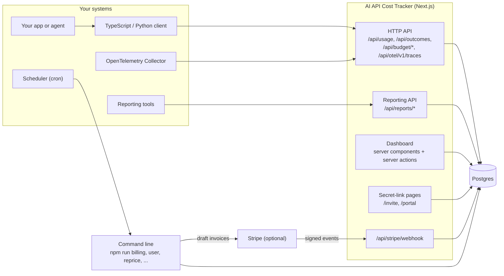

# Architecture

How the tracker fits together, and why it's built this way. It's one Next.js application backed by one Postgres database, plus command-line tools and client libraries that use the same code. For each file's job see [Project structure](../README.md#project-structure), and for the tables see [Data model](../README.md#data-model).

## Components

- **The Next.js app** (`src/app`) serves the dashboard, the HTTP APIs and two public pages reached by secret link. Dashboard pages are React server components that query the database directly. Changes go through server actions, so no data API sits between the dashboard and its data.
- **Postgres** holds everything: usage, prices, budgets, accounts, sessions, rate-limit counters, the audit log and the billing ledger. The schema is in `src/db/schema.ts`, and drizzle-kit generates the migrations in `drizzle/`. The database enforces as much as it can itself: check constraints, foreign keys that include the organization, unique keys for idempotency, and triggers that keep the ledger append-only.
- **The command line** (`src/db/scripts`, run with `npm run ...`) covers what has no page yet, and what a scheduler runs. That includes billing, repricing, reconciliation, budget alerts, accounts and organizations. The scripts call the same `src/db` functions as the app, write the same audit entries, and record their actor as "command line".
- **The clients** (`clients/typescript`, `clients/python`) have no dependencies. They read usage from OpenAI, Anthropic and Gemini responses, including streams, and report it, in the background if asked. They also wrap the budget and outcome APIs.
- **Nothing runs in the background inside the app.** Budget notifications (`npm run budget-alerts`) and monthly charges (`npm run billing -- charge`) are commands you schedule. They can run again safely: each notification and each month's charge happens once.

## Main paths

**Recording usage** (`POST /api/usage`):

1. The API key is checked: a SHA-256 hash in constant time, and the key's scope must be `ingest`. After too many invalid keys from one address, requests get a 429.
2. The body is validated (`src/lib/usage.ts`).
3. `recordUsage` (`src/db/usage.ts`) runs. A repeated `requestId` returns the stored event, as a 200 rather than a 201. Otherwise it looks up the price in effect when the usage **occurred**, computes the cost exactly, and stores the event. If a `reservationId` is given, it settles that budget hold.
4. With no price for that time, the event is stored **unpriced**, never at a guessed price. `npm run reprice` prices it once a price is added.

OpenTelemetry traces (`/api/otel/v1/traces`) are turned into the same usage records.

**Holding budget before spending** (`/api/budget/reserve`): the project's row is locked for the transaction. If the call names a customer, so is that customer's row. Concurrent holds are therefore decided one after another, each seeing the holds before it. A hold counts like spend until usage settles it, it's released, or it expires. This is how an agent stays under a run budget even when steps run in parallel; see [examples/multi-model-agent](../examples/multi-model-agent/README.md).

**Reading reports** (`/api/reports/spend`, `/api/reports/usage`): reports need a key with the `read` scope, and only cover that key's project. A key embedded in an app, which sends usage, can't read cost data.

**The dashboard:** every page and every server action calls `requireUser()` or `requirePermission()` (`src/lib/auth.ts`). They check both the session and the role, since a server action is a public endpoint that can be called from anywhere. Queries take an `OrganizationScope` as a required argument (`src/db/scope.ts`), so a query that forgets to filter by organization doesn't compile.

**Billing a month:** `npm run billing -- charge` runs after a month ends. For each customer on a plan, it posts the plan fee and the usage beyond the allowance at the plan's multiplier to an append-only ledger, then applies prepaid credit. It refuses to charge while any of the month's usage is unpriced. Optional Stripe invoicing turns open ledger entries into draft invoices, and signed webhooks post payments back. See [docs/BILLING.md](BILLING.md).

**Secret links:** invitations (`/invite/<token>`) and customer portal links (`/portal/<token>`) are pages reached by link, with no account needed. The 256-bit token in the link is the credential, so only its SHA-256 hash is stored. Links expire, can be revoked, and are shown only once. Every unusable link gets the same message. These pages send no `Referer` and ask not to be indexed.

## Who can see what

- **Organizations** keep tenants apart. Projects, accounts, billing customers, the audit log and links all belong to one organization. Billing tables use foreign keys that include the organization, so a row can't point at another organization's customer. The one install-wide thing is the price list, which only admins of the default organization can change.
- **Accounts** sign in with a password, or with OpenID Connect by verified email. A session is a random token in an `httpOnly` cookie. Only its hash is stored, and it lasts 30 days. Signing out, or `npm run user -- revoke-sessions`, deletes it on the server.
- **Roles** (`src/lib/roles.ts`): every role can read the dashboard. Members also manage projects and budgets. Admins also manage API keys, accounts, invitations, portal links and the audit log, and an organization always keeps at least one admin.
- **API keys** belong to one project and have one scope: `ingest` or `read`.

## Money

- **Exact amounts:** money is a whole number of micro-dollars, held as `bigint` in code and as `numeric` with six decimals in the database, never as a float. A request's cost is rounded once, half up, to the micro-dollar.
- **Prices:** prices are dated, sourced and audited. Usage is priced at the rate in effect when it happened, so changing a price never rewrites history.
- **Provider cost vs billing:** what providers charge you (`usage_events.cost_usd`) and what you bill customers (the ledger) are kept apart. Revenue minus AI API cost is reported as exactly that, and never called profit.
- **What customers see:** the portal and Stripe line items show billed amounts only, never AI API cost, multipliers or who entered something.

## Doing it once

Retries are expected everywhere, so each write has a key that makes a repeat harmless:

| Write              | Key                                   |
| ------------------ | ------------------------------------- |
| Usage              | `requestId`, per project and provider |
| Budget holds       | `reservationId`                       |
| Outcomes           | `outcomeId`                           |
| Ledger adjustments | `--key`                               |
| Credit grants      | `--key`                               |
| Monthly charges    | Customer and month                    |
| Stripe calls       | An `Idempotency-Key`                  |
| Stripe webhooks    | The Stripe event ID                   |

Each change is saved in the same transaction as its audit entry (`audited()` in `src/db/audit.ts`), so neither exists without the other.

## Tests

- **Unit tests** (`*.test.ts`, Vitest) cover the pure logic: cost maths, parsing, rules and formatting.
- **Integration tests** (`*.integration.test.ts`) run the database code against a real, migrated Postgres. That includes concurrency, such as two holds or two role changes racing.
- **End-to-end checks in CI:** a dev server is driven through its real forms and APIs (`scripts/smoke-projects.mjs`), and the sample apps, demos and command-line tools run with their output checked.

See [Testing](../README.md#testing) for what each CI job runs.
